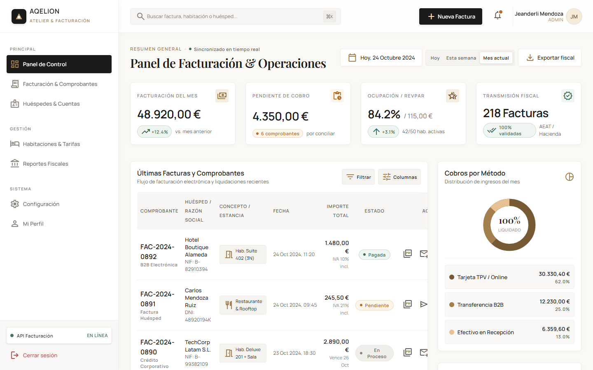
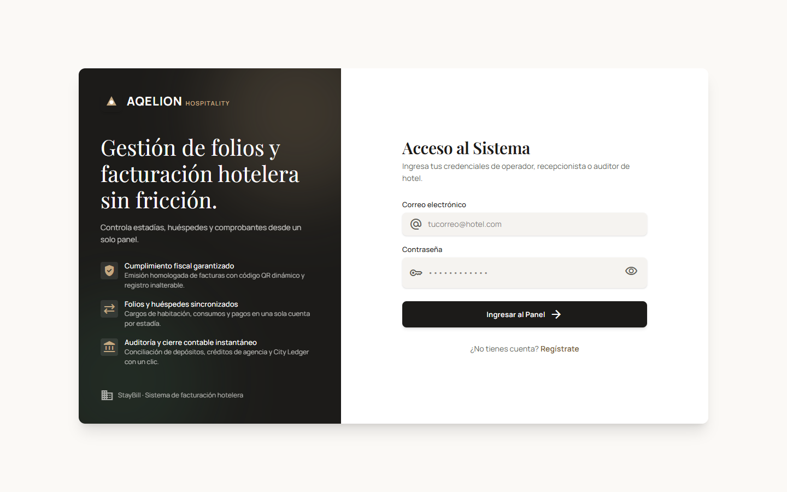
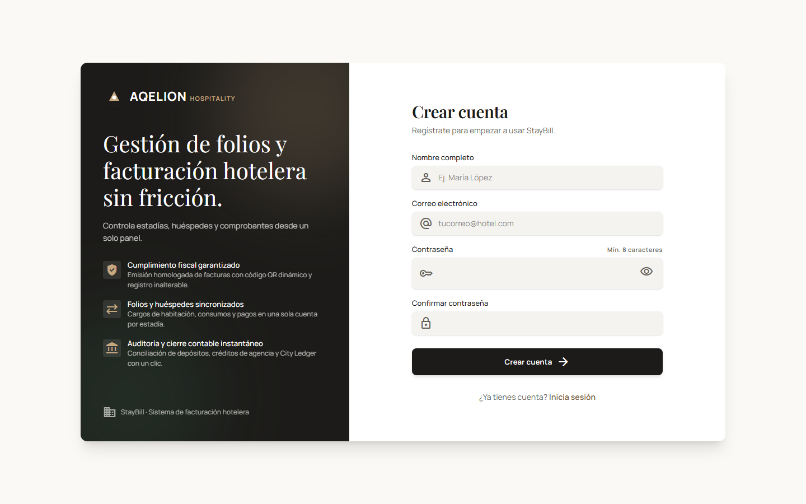
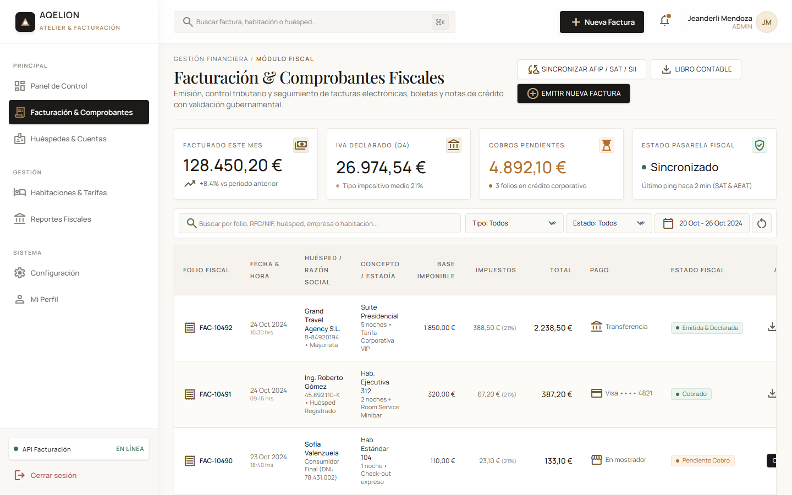
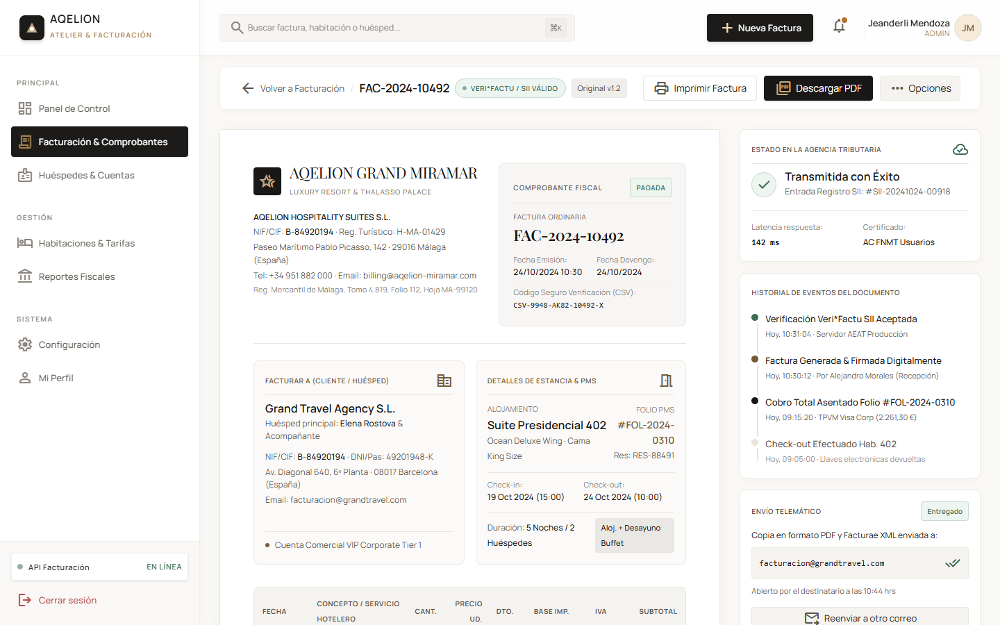
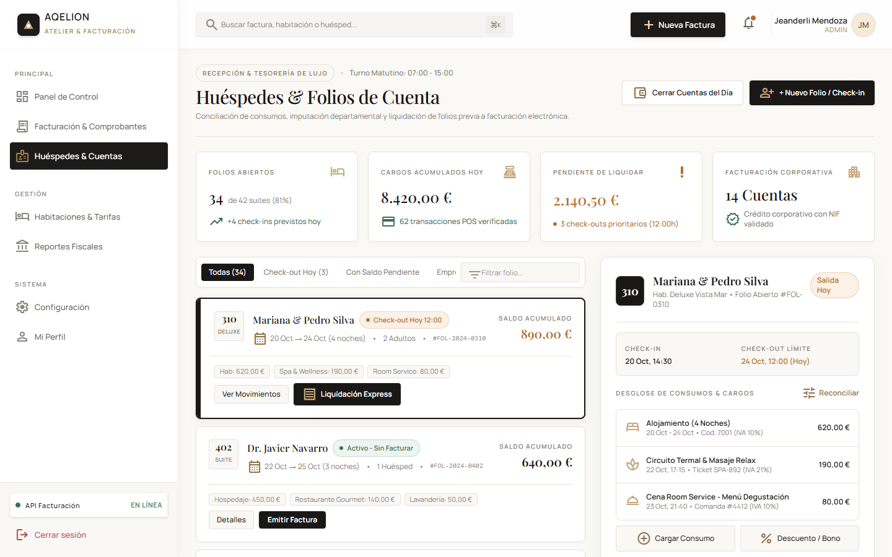

# StayBill — Sistema de facturación hotelera

Aplicación cliente-servidor para gestionar folios, huéspedes y la facturación de un hotel.
Proyecto universitario: API REST en **Spring Boot** + frontend en **React**.



## Tecnologías

| Parte | Tecnologías |
|---|---|
| Backend | Java 21, Spring Boot 4, Spring Security (BCrypt), Spring Data JPA, PostgreSQL |
| Frontend | React 19, Vite, React Router, Tailwind CSS 4, Axios |
| Diseño | Google Stitch |

## Capturas

### Inicio de sesión


### Registro


### Panel de control


### Facturación y comprobantes


### Detalle de factura


### Huéspedes y cuentas


## Estructura

```
staybill/
├── staybill/               # Backend (Spring Boot)
├── frontend-app-ing-web/   # Frontend (React + Vite)
├── docs/capturas/          # Capturas del README
├── PLAN_DE_TRABAJO.md      # Plan por fases
└── ESTADO_DEL_PROYECTO.md  # Avance del proyecto
```

## Cómo ejecutarlo

### 1. Base de datos
Crear una base PostgreSQL llamada `staybill` y poner tu usuario y contraseña en
`staybill/src/main/resources/application.properties`.

### 2. Backend (puerto 8080)
```bash
cd staybill
./mvnw spring-boot:run
```

### 3. Frontend (puerto 5173)
```bash
cd frontend-app-ing-web
cp .env.example .env
bun install      # o: npm install
bun run dev      # o: npm run dev
```

Abrir http://localhost:5173

## Endpoints disponibles

| Método | Ruta | Descripción |
|---|---|---|
| POST | `/api/auth/registro` | Crea un usuario (contraseña encriptada con BCrypt). 409 si el correo ya existe |
| POST | `/api/auth/login` | Inicia sesión. 401 credenciales incorrectas, 403 cuenta inactiva |

## Estado

El avance por fases está en [ESTADO_DEL_PROYECTO.md](ESTADO_DEL_PROYECTO.md).

## Autor

Jeanderli Mendoza — [@Jeanderli](https://github.com/Jeanderli)
